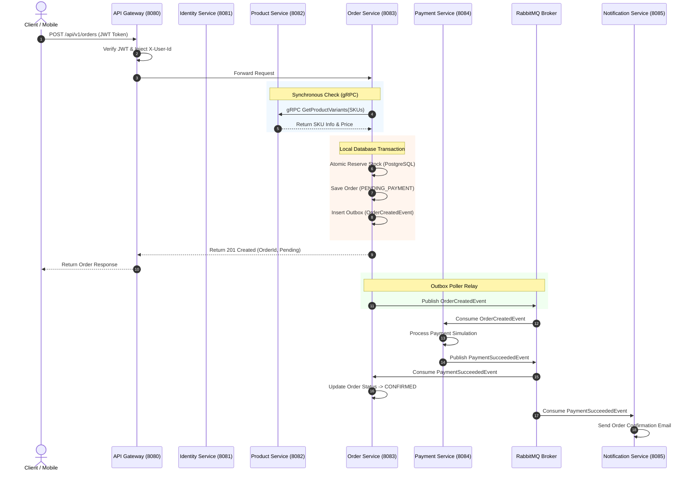

# Domain-Driven Design (DDD) Specification — Omnichannel E-Commerce Platform (Project MD5)

## 1. Tổng quan Kiến trúc Domain Driven Design
Hệ thống **Omnichannel E-Commerce Platform** được thiết kế theo các nguyên tắc Domain-Driven Design (DDD). Domain tổng thể được chia thành các **Bounded Contexts** độc lập. Mỗi Bounded Context được sở hữu và triển khai bởi một Microservice riêng biệt với Database độc lập (Database Per Service pattern).

```
+-----------------------------------------------------------------------------------+
|                            OMNICHANNEL E-COMMERCE DOMAIN                          |
+-------------------+--------------------+--------------------+---------------------+
| Identity Context  | Catalog Context    | Order & Inventory  | Payment Context     |
| (PostgreSQL)      | (Mongo + ES)       | Context (Postgres) | (PostgreSQL)        |
|                   |                    |                    |                     |
| - User Aggregate  | - Product Agg      | - Order Aggregate  | - Payment Transaction|
| - Role/Perm       | - Category Agg     | - Inventory Agg    |   Aggregate         |
| - Address VO      | - Brand Agg        | - Reservation VO   | - Payment Method VO |
+-------------------+--------------------+--------------------+---------------------+
                                         | Notification Context (MongoDB)           |
                                         | - NotificationLog Aggregate              |
                                         | - Template VO                            |
                                         +------------------------------------------+
```

---

## 2. Chi tiết các Bounded Contexts

### 2.1. Identity & Access Management Context (`Identity Service`)

#### Responsibilities
Quản lý thông tin định danh người dùng, xác thực (Authentication), phân quyền (Authorization - RBAC), token lifecycle và quản lý địa chỉ nhận hàng.

#### Aggregates, Entities & Value Objects
- **User Aggregate Root:** `User`
  - *Entities:* `User`, `Role`, `Permission`
  - *Value Objects:* `UserId`, `Email`, `HashedPassword`, `PhoneNumber`, `UserStatus` (`ACTIVE`, `SUSPENDED`, `LOCKED`)
  - *Associated Entities:* `Address` (Entities/VO), `RefreshToken`
- **Address Value Object / Entity:**
  - `AddressId`, `RecipientName`, `Phone`, `Street`, `Ward`, `District`, `City`, `IsDefault`

#### Business Rules & Invariants
1. Email phải là duy nhất trên toàn bộ hệ thống.
2. Mật khẩu lưu trữ bắt buộc phải được băm bằng thuật toán BCrypt.
3. Refresh Token khi được sử dụng phải được xoay vòng (Token Rotation) và có cơ chế Revoke tức thì nếu phát hiện sử dụng lại token cũ.

#### Domain Events
- `UserRegisteredEvent` (`userId`, `email`, `fullName`, `createdAt`)
- `UserPasswordResetEvent` (`userId`, `email`, `timestamp`)

---

### 2.2. Product Catalog & Search Context (`Product Catalog Service`)

#### Responsibilities
Quản lý thông tin sản phẩm, danh mục sản phẩm đa cấp, thương hiệu, các biến thể sản phẩm (SKU) và cung cấp khả năng tìm kiếm siêu tốc bằng Elasticsearch.

#### Aggregates, Entities & Value Objects
- **Product Aggregate Root:** `Product`
  - *Entities:* `Product`, `ProductVariant` (SKU)
  - *Value Objects:* `ProductId`, `SkuCode`, `ProductName`, `Slug`, `Money` (Amount, Currency), `ProductAttribute` (Color, Size, Spec), `ProductStatus` (`DRAFT`, `ACTIVE`, `OUT_OF_STOCK`, `DISCONTINUED`)
- **Category Aggregate Root:** `Category`
  - *Value Objects:* `CategoryId`, `CategoryName`, `ParentCategoryId` (Tree structure)
- **Brand Aggregate Root:** `Brand`
  - *Value Objects:* `BrandId`, `BrandName`, `LogoUrl`

#### Business Rules & Invariants
1. Mỗi `ProductVariant` phải sở hữu một mã `skuCode` duy nhất trên toàn hệ thống.
2. Mỗi sản phẩm phải có ít nhất 1 biến thể SKU active mới được phép chuyển trạng thái sang `ACTIVE`.
3. Giá bán (`regularPrice`) phải lớn hơn 0; giá khuyến mãi (`salePrice`) nếu có phải nhỏ hơn hoặc bằng giá bán.

#### Domain Events
- `ProductCreatedEvent` (`productId`, `skus`, `timestamp`)
- `ProductUpdatedEvent` (`productId`, `updatedFields`, `timestamp`)
- `ProductVariantPriceChangedEvent` (`skuCode`, `oldPrice`, `newPrice`)

---

### 2.3. Order & Inventory Context (`Order & Inventory Service` - Core Context)

#### Responsibilities
Tiếp nhận đơn hàng, điều phối quy trình thanh toán (Saga Orchestrator), quản lý số lượng tồn kho khả dụng, tạm giữ kho (Stock Reservation) và chống overselling dưới tải cao.

#### Aggregates, Entities & Value Objects
- **Order Aggregate Root:** `Order`
  - *Entities:* `Order`, `OrderItem`
  - *Value Objects:* `OrderId`, `OrderNumber`, `CustomerId`, `OrderStatus` (`PENDING_PAYMENT`, `CONFIRMED`, `SHIPPING`, `COMPLETED`, `CANCELLED`, `REFUNDED`), `ShippingAddressVO`, `Money` (TotalAmount, TaxAmount, ShippingFee)
- **Inventory Aggregate Root:** `Inventory`
  - *Entities:* `Inventory`, `StockReservation`
  - *Value Objects:* `InventoryId`, `SkuCode`, `AvailableQuantity`, `ReservedQuantity`, `ReservationId`, `ReservationStatus` (`ACTIVE`, `EXPIRED`, `COMMITTED`, `RELEASED`), `ExpirationTime`

#### Business Rules & Invariants
1. `AvailableQuantity` không bao giờ được phép âm (`availableQuantity >= 0`).
2. Việc tạm giữ kho (`StockReservation`) phải thực hiện bằng câu lệnh Atomic Conditional Update tại Database layer để đảm bảo tính nhất quán tuyệt đối.
3. Một `StockReservation` có thời gian hết hạn (TTL mặc định = 15 phút). Nếu quá 15 phút mà đơn hàng chưa thanh toán, kho phải tự động hoàn lại cho `AvailableQuantity`.
4. Đơn hàng chỉ được chuyển từ `PENDING_PAYMENT` sang `CONFIRMED` khi nhận được sự kiện `PaymentSucceededEvent`.

#### Domain Events
- `OrderCreatedEvent` (`orderId`, `orderNumber`, `customerId`, `totalAmount`, `items`, `timestamp`)
- `StockReservedEvent` (`orderId`, `reservationId`, `items`, `timestamp`)
- `StockReservationFailedEvent` (`orderId`, `reason`, `timestamp`)
- `OrderConfirmedEvent` (`orderId`, `orderNumber`, `timestamp`)
- `OrderCancelledEvent` (`orderId`, `reason`, `timestamp`)

---

### 2.4. Payment Context (`Payment Service`)

#### Responsibilities
Xử lý giao dịch thanh toán trực tuyến, kết nối/mô phỏng cổng thanh toán (Payment Gateway), ghi nhận nhật ký giao dịch và hỗ trợ hoàn tiền (Refund).

#### Aggregates, Entities & Value Objects
- **Payment Transaction Aggregate Root:** `PaymentTransaction`
  - *Value Objects:* `PaymentId`, `OrderId`, `TransactionRef`, `Money` (Amount, Currency), `PaymentMethod` (`VNPAY`, `MOMO`, `CREDIT_CARD`, `MOCK`), `PaymentStatus` (`PENDING`, `SUCCESS`, `FAILED`, `REFUNDED`), `FailureReason`

#### Business Rules & Invariants
1. Mỗi đơn hàng chỉ có duy nhất một giao dịch thanh toán thành công.
2. Mã giao dịch (`TransactionRef`) từ cổng thanh toán phải là duy nhất.
3. Khi nhận được yêu cầu hoàn tiền (Refund), số tiền hoàn lại không được vượt quá số tiền đã thanh toán ban đầu.

#### Domain Events
- `PaymentSucceededEvent` (`paymentId`, `orderId`, `transactionRef`, `amount`, `timestamp`)
- `PaymentFailedEvent` (`paymentId`, `orderId`, `errorCode`, `errorMessage`, `timestamp`)
- `PaymentRefundedEvent` (`paymentId`, `orderId`, `refundAmount`, `timestamp`)

---

### 2.5. Notification Context (`Notification Service`)

#### Responsibilities
Tiếp nhận sự kiện từ hệ thống, render nội dung theo mẫu (Templates) và gửi thông báo (Email, SMS) đến người dùng cuối.

#### Aggregates, Entities & Value Objects
- **Notification Log Aggregate Root:** `NotificationLog`
  - *Value Objects:* `NotificationId`, `RecipientEmail`, `NotificationType` (`ORDER_CONFIRMATION`, `PAYMENT_SUCCESS`, `ORDER_CANCELLED`), `Status` (`PENDING`, `SENT`, `FAILED`), `ErrorMessage`, `RetryCount`

#### Business Rules & Invariants
1. Đảm bảo Idempotent Consumer: Không gửi trùng lặp email cho cùng một `eventId`.
2. Lưu vết toàn bộ lịch sử gửi thông báo phục vụ mục đích kiểm toán (Audit Log).

---

## 3. Luồng Giao tiếp giữa các Bounded Contexts



---

## 4. Thực thi nguyên tắc Database Per Service

1. **Cô lập về mặt vật lý / schema:** Mỗi Microservice quản lý một Database Instance riêng biệt hoặc Database Schema hoàn toàn độc lập với User DB khác nhau.
2. **Không Cross-Database Queries:** Cấm tuyệt đối việc sử dụng Foreign Keys cross-database hoặc viết câu lệnh `JOIN` giữa DB của service này và DB của service khác.
3. **Data Access qua API / Events:** Mọi thao tác lấy thông tin từ service khác phải đi qua gRPC/REST API đồng bộ hoặc lắng nghe Domain Events bất đồng bộ.
