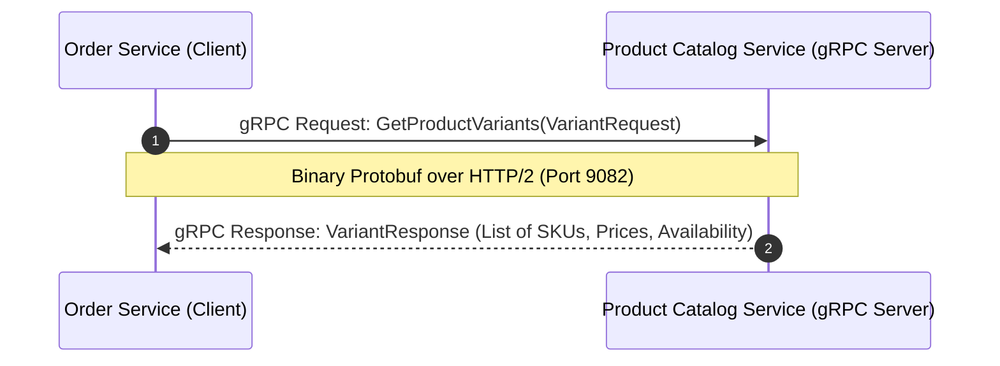
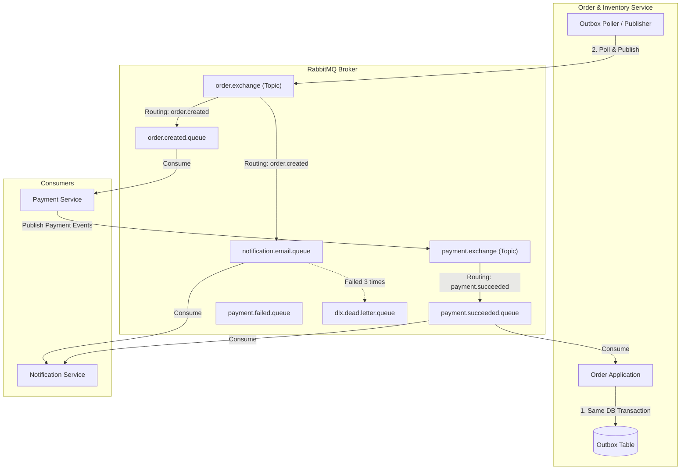

# Communication Flow Specification — Omnichannel E-Commerce Platform (Project MD5)

## 1. Cơ chế Giao tiếp Đồng bộ (Synchronous Communication)

### 1.1. RESTful API (HTTP/1.1 & HTTP/2 JSON)
Sử dụng cho giao tiếp từ Client -> API Gateway và từ API Gateway -> Microservices.

- **Định dạng:** JSON (Application/json).
- **Mã lỗi chuẩn:** RFC 7807 Problem Details.
- **Xác thực:** Bearer JWT Header.

### 1.2. Internal gRPC Protocol Buffers (HTTP/2)
Sử dụng cho giao tiếp nội bộ giữa **Order Service** và **Product Catalog Service**.

#### Lý do chọn gRPC:
- **Tốc độ & Latency:** Sử dụng mã hóa nhị phân (Protobuf) trên nền HTTP/2 Multiplexing cho tốc độ phản hồi < 5ms.
- **Strong Contract:** Proto file định nghĩa rõ ràng kiểu dữ liệu, tránh sai sót truyền nhận giữa các service.



#### Protocol Buffers Spec (`product_service.proto`):
```protobuf
syntax = "proto3";

package com.ecommerce.product.grpc;

option java_multiple_files = true;
option java_package = "com.ecommerce.product.grpc";

service ProductGrpcService {
  rpc GetProductVariants (VariantRequest) returns (VariantResponse);
}

message VariantRequest {
  repeated string skuCodes = 1;
}

message VariantInfo {
  string skuCode = 1;
  string productId = 2;
  string productName = 3;
  double price = 4;
  bool isActive = 5;
}

message VariantResponse {
  repeated VariantInfo variants = 1;
}
```

---

## 2. Cơ chế Giao tiếp Bất đồng bộ (Asynchronous Event-Driven Communication)

Sử dụng **RabbitMQ Message Broker** theo mô hình Publisher - Subscriber với Transactional Outbox Pattern.



---

## 3. Tổng hợp Event Flow toàn bộ Hệ thống

| Event Name | Publisher | Exchange | Routing Key | Consumers | Hành động của Consumer |
| :--- | :--- | :--- | :--- | :--- | :--- |
| `OrderCreatedEvent` | Order Service | `order.exchange` | `order.created` | Payment Service<br>Notification Service | Payment Svc khởi tạo giao dịch thanh toán.<br>Notification Svc gửi email nhận đơn hàng. |
| `PaymentSucceededEvent` | Payment Service | `payment.exchange` | `payment.succeeded` | Order Service<br>Notification Service | Order Svc cập nhật trạng thái đơn thành `CONFIRMED`.<br>Notification Svc gửi email xác nhận thanh toán. |
| `PaymentFailedEvent` | Payment Service | `payment.exchange` | `payment.failed` | Order Service<br>Notification Service | Order Svc kích hoạt Saga Compensation giải phóng kho và chuyển trạng thái `CANCELLED`. |
| `StockReservationFailedEvent`| Order Service | `order.exchange` | `order.stock_failed`| Notification Service | Notification Svc gửi email thông báo hết hàng. |
| `OrderCancelledEvent` | Order Service | `order.exchange` | `order.cancelled` | Notification Service | Notification Svc gửi email thông báo hủy đơn. |
