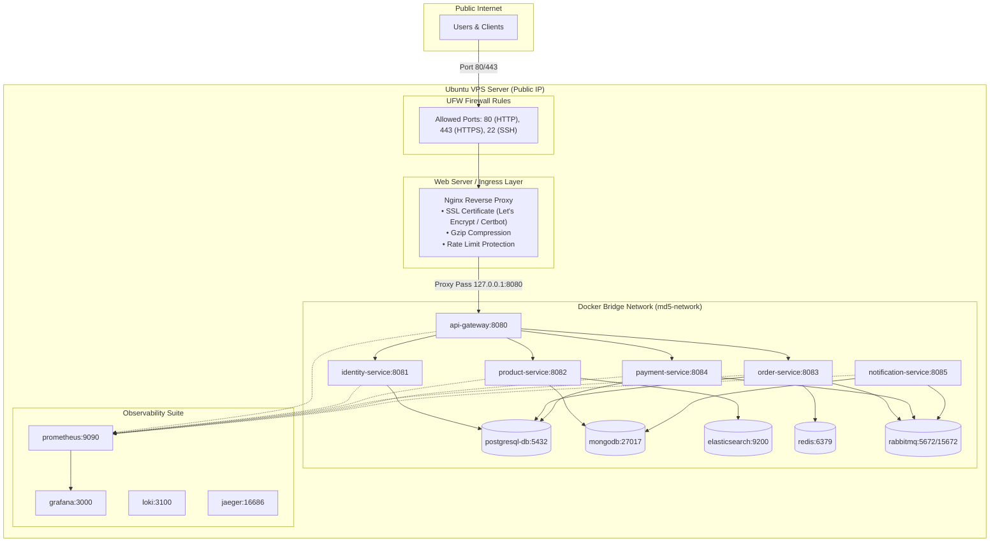
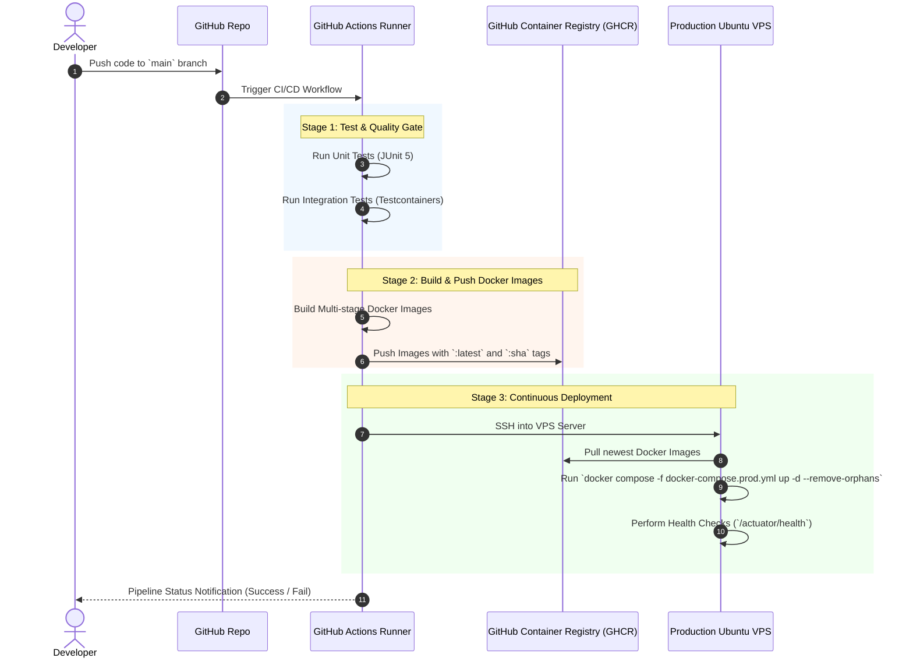

# Deployment & DevOps Architecture Specification — Omnichannel E-Commerce Platform (Project MD5)

## 1. Môi trường Triển khai Production trên Ubuntu VPS

Hệ thống được thiết kế để triển khai sản xuất trên hạ tầng **Ubuntu Linux VPS (22.04 LTS)** bằng Docker Compose và Nginx Reverse Proxy.



---

## 2. Docker Multi-Stage Build Architecture

Mọi Microservice Spring Boot được đóng gói bằng **Dockerfile Multi-stage** để tối ưu dung lượng Image (< 250MB) và đảm bảo an ninh (Non-root user).

### Dockerfile Template Chuẩn Enterprise:
```dockerfile
# Stage 1: Build Jar bằng Gradle Image
FROM gradle:8.5-jdk17-alpine AS builder
WORKDIR /app
COPY build.gradle settings.gradle ./
COPY gradle ./gradle
COPY src ./src
RUN gradle bootJar --no-daemon -x test

# Stage 2: Runtime với Eclipse Temurin JRE
FROM eclipse-temurin:17-jre-alpine
WORKDIR /app

# Tạo non-root user đảm bảo an toàn
RUN addgroup -S appgroup && adduser -S appuser -G appgroup
USER appuser

COPY --from=builder /app/build/libs/*.jar app.jar

EXPOSE 8080
ENTRYPOINT ["java", "-XX:+UseG1GC", "-XX:MaxRAMPercentage=75.0", "-jar", "app.jar"]
```

---

## 3. GitHub Actions CI/CD Pipeline

Quy trình tự động hóa tích hợp và triển khai liên tục (CI/CD) thông qua GitHub Actions và GHCR (GitHub Container Registry).



---

## 4. Nginx Reverse Proxy & UFW Firewall Configuration

### 4.1. UFW Firewall Rules (Cấu hình Tường lửa VPS)
```bash
sudo ufw default deny incoming
sudo ufw default allow outgoing
sudo ufw allow 22/tcp comment 'SSH Access'
sudo ufw allow 80/tcp comment 'HTTP Web'
sudo ufw allow 443/tcp comment 'HTTPS SSL Web'
sudo ufw enable
```

### 4.2. File cấu hình Nginx Server Block (`/etc/nginx/sites-available/omnichannel.conf`)
```nginx
server {
    listen 80;
    server_name api.yourdomain.com;
    return 301 https://$host$request_uri;
}

server {
    listen 443 ssl http2;
    server_name api.yourdomain.com;

    ssl_certificate /etc/letsencrypt/live/api.yourdomain.com/fullchain.pem;
    ssl_certificate_key /etc/letsencrypt/live/api.yourdomain.com/privkey.pem;
    ssl_protocols TLSv1.2 TLSv1.3;

    # Rate Limit Zone Definition
    limit_req zone=api_limit burst=20 nodelay;

    location / {
        proxy_pass http://127.0.0.1:8080;
        proxy_set_header Host $host;
        proxy_set_header X-Real-IP $remote_addr;
        proxy_set_header X-Forwarded-For $proxy_add_x_forwarded_for;
        proxy_set_header X-Forwarded-Proto $scheme;
        proxy_connect_timeout 60s;
        proxy_read_timeout 60s;
    }
}
```

---

## 5. Chiến lược Backup, Restore & Zero-Downtime Rollback

- **Backup Tự động:** Cronjob chạy hàng ngày lúc 2:00 AM dump PostgreSQL `pg_dumpall` và MongoDB `mongodump` nén và lưu vào AWS S3/Object Storage.
- **Zero-Downtime Deployment:** Sử dụng Docker Compose Rolling update bằng cách reload từng service một.
- **Rollback Plan:** Nếu deployment bị lỗi Health check, GitHub Actions chạy lệnh rollback về SHA image trước đó: `docker compose pull <image_sha> && docker compose up -d`.
