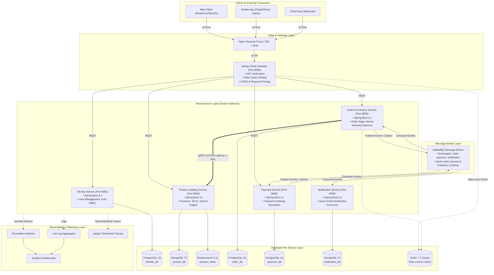
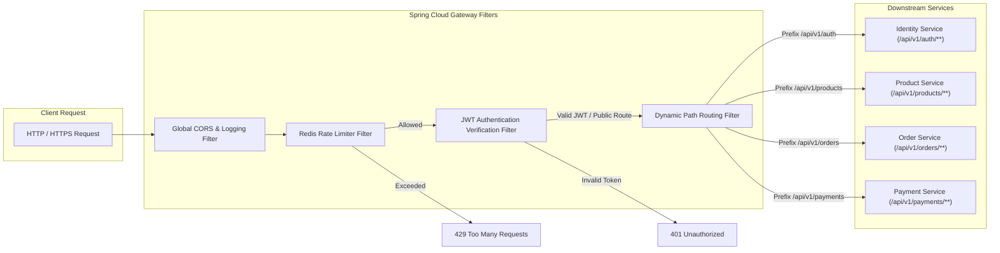

# System Architecture Specification — Omnichannel E-Commerce Platform (Project MD5)

## 1. Tổng quan Kiến trúc Microservices System Architecture

Hệ thống được xây dựng theo kiến trúc **Distributed Microservices** hoàn chỉnh, đảm bảo tính mô-đun hóa, khả năng mở rộng độc lập và chịu tải cao.

---

## 2. API Gateway Routing Architecture

API Gateway (`Spring Cloud Gateway`) hoạt động như Single Point of Entry duy nhất cho hệ thống.

---

## 3. Database Architecture (Database Per Service)

Kiến trúc đảm bảo mỗi Microservice làm chủ hoàn toàn dữ liệu của mình:

| Service | Database Engine | Loại hình Dữ liệu | Lý do lựa chọn |
| :--- | :--- | :--- | :--- |
| **Identity Service** | PostgreSQL 16 | Relational SQL | Đảm bảo tính toàn vẹn quan hệ (Users, Roles, Addresses), ACID transactions. |
| **Product Catalog Service** | MongoDB 7.0 + Elasticsearch 8 | Document NoSQL + Search Engine | Schema linh hoạt cho thuộc tính sản phẩm (Attributes, Variants), Elasticsearch cho full-text search. |
| **Order & Inventory Service** | PostgreSQL 16 + Redis 7.2 | Relational SQL + In-Memory | ACID cao cho đơn hàng, PostgreSQL Atomic Update cho tồn kho, Redis cho Distributed Lock. |
| **Payment Service** | PostgreSQL 16 | Relational SQL | Đảm bảo độ chính xác tài chính 100%, Audit log giao dịch khắt khe. |
| **Notification Service** | MongoDB 7.0 | Document NoSQL | Lưu trữ Log gửi email linh hoạt dạng JSON document. |
