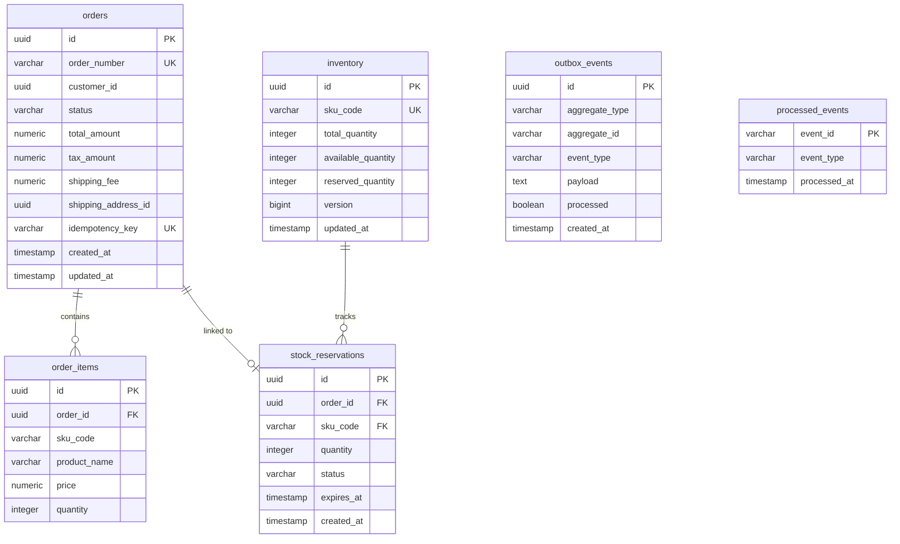

# Order & Inventory Service Database Schema Specification (PostgreSQL)

## 1. Overview & ER Diagram
Database `order_db` sử dụng **PostgreSQL 16**. Đây là Core Database chịu trách nhiệm quản lý Đơn hàng, Tồn kho (Atomic Stock Level), Stock Reservations, Transactional Outbox Events và Processed Events (Idempotency).



---

## 2. SQL DDL Specifications

```sql
CREATE EXTENSION IF NOT EXISTS "uuid-ossp";

-- Table: orders
CREATE TABLE orders (
    id UUID PRIMARY KEY DEFAULT uuid_generate_v4(),
    order_number VARCHAR(50) NOT NULL UNIQUE,
    customer_id UUID NOT NULL,
    status VARCHAR(30) NOT NULL, -- PENDING_PAYMENT, CONFIRMED, SHIPPING, COMPLETED, CANCELLED, REFUNDED
    total_amount NUMERIC(15, 2) NOT NULL,
    tax_amount NUMERIC(15, 2) NOT NULL DEFAULT 0.00,
    shipping_fee NUMERIC(15, 2) NOT NULL DEFAULT 0.00,
    shipping_address_id UUID NOT NULL,
    idempotency_key VARCHAR(128) UNIQUE,
    created_at TIMESTAMP WITH TIME ZONE DEFAULT CURRENT_TIMESTAMP,
    updated_at TIMESTAMP WITH TIME ZONE DEFAULT CURRENT_TIMESTAMP
);

CREATE INDEX idx_orders_customer_id ON orders(customer_id);
CREATE INDEX idx_orders_status ON orders(status);

-- Table: order_items
CREATE TABLE order_items (
    id UUID PRIMARY KEY DEFAULT uuid_generate_v4(),
    order_id UUID NOT NULL REFERENCES orders(id) ON DELETE CASCADE,
    sku_code VARCHAR(100) NOT NULL,
    product_name VARCHAR(255) NOT NULL,
    price NUMERIC(15, 2) NOT NULL,
    quantity INTEGER NOT NULL CHECK (quantity > 0)
);

CREATE INDEX idx_order_items_order_id ON order_items(order_id);

-- Table: inventory (CORE CONCURRENCY CONTROL)
CREATE TABLE inventory (
    id UUID PRIMARY KEY DEFAULT uuid_generate_v4(),
    sku_code VARCHAR(100) NOT NULL UNIQUE,
    total_quantity INTEGER NOT NULL CHECK (total_quantity >= 0),
    available_quantity INTEGER NOT NULL CHECK (available_quantity >= 0),
    reserved_quantity INTEGER NOT NULL CHECK (reserved_quantity >= 0),
    version BIGINT NOT NULL DEFAULT 0,
    updated_at TIMESTAMP WITH TIME ZONE DEFAULT CURRENT_TIMESTAMP,
    CONSTRAINT chk_inventory_sum CHECK (total_quantity = available_quantity + reserved_quantity)
);

CREATE INDEX idx_inventory_sku_code ON inventory(sku_code);

-- Table: stock_reservations
CREATE TABLE stock_reservations (
    id UUID PRIMARY KEY DEFAULT uuid_generate_v4(),
    order_id UUID NOT NULL REFERENCES orders(id) ON DELETE CASCADE,
    sku_code VARCHAR(100) NOT NULL REFERENCES inventory(sku_code),
    quantity INTEGER NOT NULL CHECK (quantity > 0),
    status VARCHAR(30) NOT NULL, -- ACTIVE, EXPIRED, COMMITTED, RELEASED
    expires_at TIMESTAMP WITH TIME ZONE NOT NULL,
    created_at TIMESTAMP WITH TIME ZONE DEFAULT CURRENT_TIMESTAMP
);

CREATE INDEX idx_reservations_status_expires ON stock_reservations(status, expires_at);

-- Table: outbox_events (TRANSACTIONAL OUTBOX PATTERN)
CREATE TABLE outbox_events (
    id UUID PRIMARY KEY DEFAULT uuid_generate_v4(),
    aggregate_type VARCHAR(100) NOT NULL,
    aggregate_id VARCHAR(100) NOT NULL,
    event_type VARCHAR(100) NOT NULL,
    payload TEXT NOT NULL,
    processed BOOLEAN NOT NULL DEFAULT FALSE,
    created_at TIMESTAMP WITH TIME ZONE DEFAULT CURRENT_TIMESTAMP
);

CREATE INDEX idx_outbox_unprocessed ON outbox_events(processed, created_at) WHERE processed = FALSE;

-- Table: processed_events (IDEMPOTENT CONSUMER PATTERN)
CREATE TABLE processed_events (
    event_id VARCHAR(128) PRIMARY KEY,
    event_type VARCHAR(100) NOT NULL,
    processed_at TIMESTAMP WITH TIME ZONE DEFAULT CURRENT_TIMESTAMP
);
```
