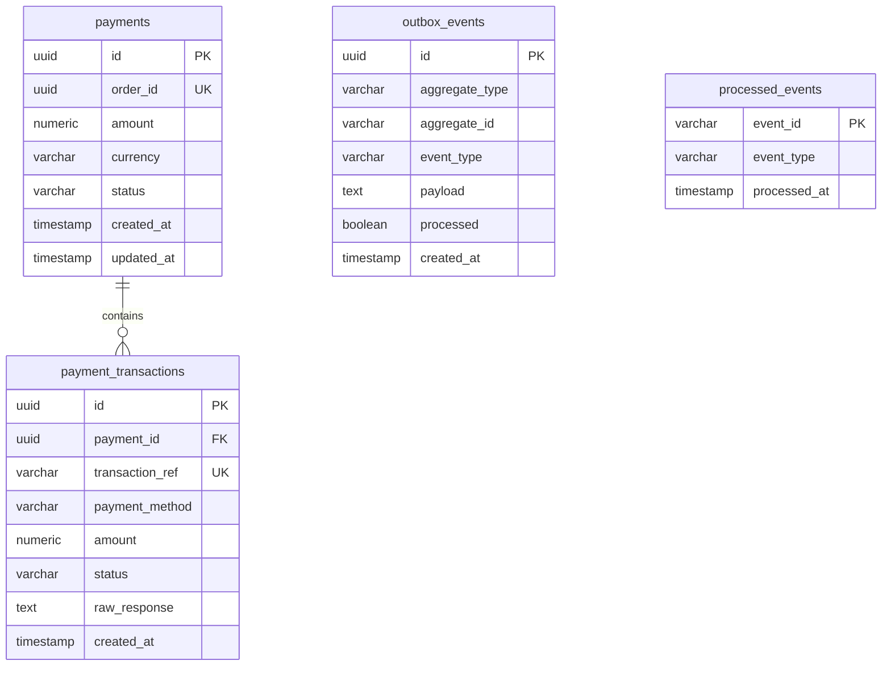

# Payment Service Database Schema Specification (PostgreSQL)

## 1. Overview & ER Diagram
Database `payment_db` sử dụng **PostgreSQL 16** để đảm bảo tính toàn vẹn dữ liệu tài chính tuyệt đối, lưu vết giao dịch thanh toán, transactional outbox events và processed events cho Saga pattern.



---

## 2. SQL DDL Specifications

```sql
CREATE EXTENSION IF NOT EXISTS "uuid-ossp";

-- Table: payments
CREATE TABLE payments (
    id UUID PRIMARY KEY DEFAULT uuid_generate_v4(),
    order_id UUID NOT NULL UNIQUE,
    amount NUMERIC(15, 2) NOT NULL CHECK (amount > 0),
    currency VARCHAR(10) NOT NULL DEFAULT 'VND',
    status VARCHAR(30) NOT NULL, -- PENDING, SUCCESS, FAILED, REFUNDED
    created_at TIMESTAMP WITH TIME ZONE DEFAULT CURRENT_TIMESTAMP,
    updated_at TIMESTAMP WITH TIME ZONE DEFAULT CURRENT_TIMESTAMP
);

CREATE INDEX idx_payments_order_id ON payments(order_id);

-- Table: payment_transactions
CREATE TABLE payment_transactions (
    id UUID PRIMARY KEY DEFAULT uuid_generate_v4(),
    payment_id UUID NOT NULL REFERENCES payments(id) ON DELETE CASCADE,
    transaction_ref VARCHAR(100) NOT NULL UNIQUE,
    payment_method VARCHAR(50) NOT NULL, -- VNPAY, MOMO, CREDIT_CARD, MOCK
    amount NUMERIC(15, 2) NOT NULL,
    status VARCHAR(30) NOT NULL, -- SUCCESS, FAILED, REFUNDED
    raw_response TEXT,
    created_at TIMESTAMP WITH TIME ZONE DEFAULT CURRENT_TIMESTAMP
);

CREATE INDEX idx_transactions_payment_id ON payment_transactions(payment_id);
CREATE INDEX idx_transactions_ref ON payment_transactions(transaction_ref);

-- Table: outbox_events
CREATE TABLE outbox_events (
    id UUID PRIMARY KEY DEFAULT uuid_generate_v4(),
    aggregate_type VARCHAR(100) NOT NULL,
    aggregate_id VARCHAR(100) NOT NULL,
    event_type VARCHAR(100) NOT NULL,
    payload TEXT NOT NULL,
    processed BOOLEAN NOT NULL DEFAULT FALSE,
    created_at TIMESTAMP WITH TIME ZONE DEFAULT CURRENT_TIMESTAMP
);

CREATE INDEX idx_payment_outbox_unprocessed ON outbox_events(processed, created_at) WHERE processed = FALSE;

-- Table: processed_events
CREATE TABLE processed_events (
    event_id VARCHAR(128) PRIMARY KEY,
    event_type VARCHAR(100) NOT NULL,
    processed_at TIMESTAMP WITH TIME ZONE DEFAULT CURRENT_TIMESTAMP
);
```
