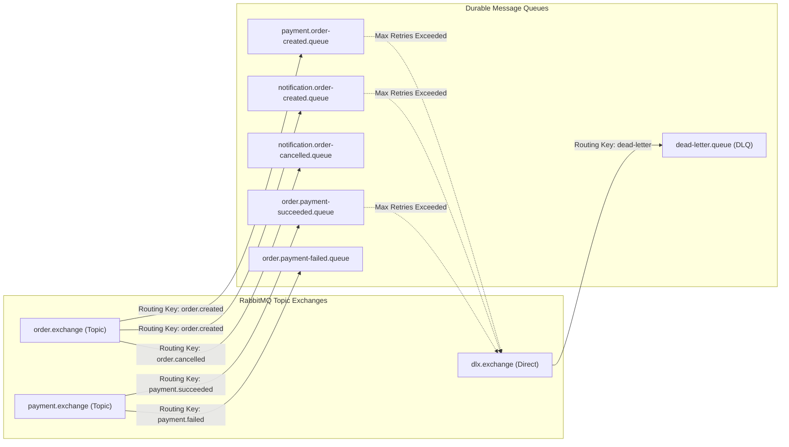

# RabbitMQ Topology Specification — Project MD5

## 1. Topo Tổng quan Exchanges & Queues

Toàn bộ thông điệp bất đồng bộ trong RabbitMQ được cấu hình bền vững (**Durable**), kèm cơ chế Dead Letter Exchange (DLX) để hứng các message bị lỗi khi retry quá số lần quy định.



---

## 2. Bảng Cấu hình Exchanges, Queues & Dead Letter Routing

| Exchange Name | Type | Queue Name | Routing Key Binding | DLX Target | Retry / TTL Strategy |
| :--- | :--- | :--- | :--- | :--- | :--- |
| `order.exchange` | Topic | `payment.order-created.queue` | `order.created` | `dlx.exchange` | Retry 3 times with exponential backoff (1s, 2s, 4s). DLQ key: `dead-letter`. |
| `order.exchange` | Topic | `notification.order-created.queue` | `order.created` | `dlx.exchange` | Retry 3 times. DLQ key: `dead-letter`. |
| `payment.exchange`| Topic | `order.payment-succeeded.queue` | `payment.succeeded` | `dlx.exchange` | Retry 3 times. DLQ key: `dead-letter`. |
| `payment.exchange`| Topic | `order.payment-failed.queue` | `payment.failed` | `dlx.exchange` | Retry 3 times. DLQ key: `dead-letter`. |
| `order.exchange` | Topic | `notification.order-cancelled.queue`| `order.cancelled` | `dlx.exchange` | Retry 3 times. DLQ key: `dead-letter`. |
| `dlx.exchange` | Direct| `dead-letter.queue` | `dead-letter` | N/A | Queue lưu trữ các message lỗi để Admin truy vấn & retry qua Web UI. |

---

## 3. Mã Cấu hình Spring AMQP (Spring Boot Java Template)

```java
@Configuration
public class RabbitMQTopologyConfig {

    public static final String ORDER_EXCHANGE = "order.exchange";
    public static final String DLX_EXCHANGE = "dlx.exchange";

    public static final String PAYMENT_ORDER_CREATED_QUEUE = "payment.order-created.queue";
    public static final String DEAD_LETTER_QUEUE = "dead-letter.queue";

    @Bean
    public TopicExchange orderExchange() {
        return new TopicExchange(ORDER_EXCHANGE, true, false);
    }

    @Bean
    public DirectExchange dlxExchange() {
        return new DirectExchange(DLX_EXCHANGE, true, false);
    }

    @Bean
    public Queue paymentOrderCreatedQueue() {
        return QueueBuilder.durable(PAYMENT_ORDER_CREATED_QUEUE)
                .withArgument("x-dead-letter-exchange", DLX_EXCHANGE)
                .withArgument("x-dead-letter-routing-key", "dead-letter")
                .build();
    }

    @Bean
    public Binding bindingPaymentOrderCreated(Queue paymentOrderCreatedQueue, TopicExchange orderExchange) {
        return BindingBuilder.bind(paymentOrderCreatedQueue)
                .to(orderExchange)
                .with("order.created");
    }
}
```
