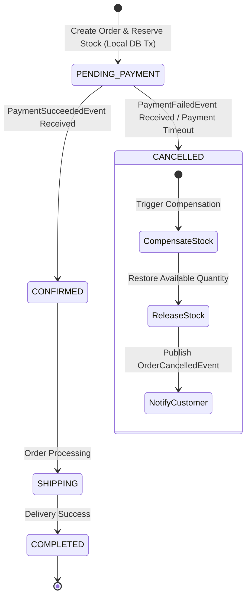
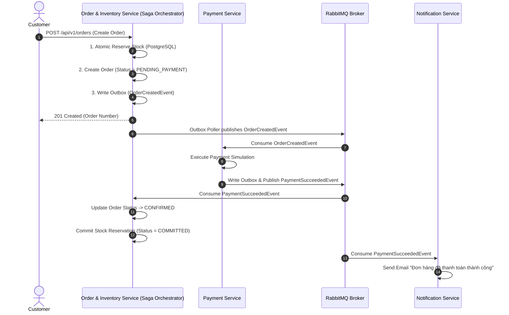

# Checkout Saga Orchestration Specification — Omnichannel E-Commerce Platform (Project MD5)

## 1. Saga Architecture & State Machine

Quy trình Checkout trong môi trường Microservices được quản lý bởi **Saga Orchestrator** đặt tại `Order & Inventory Service`.

---

## 2. Kịch bản Thành Công (Happy Path Sequence)

---

## 3. Kịch bản Thất bại & Giao dịch Bồi thường (Compensation Flow)

### 3.1. Kịch bản 1: Thanh toán thất bại (Payment Failed)
1. Payment Service thử thanh toán không thành công (Thẻ hết hạn, không đủ tiền).
2. Payment Service phát sự kiện `PaymentFailedEvent` (`orderId`, `reason`).
3. Order Service lắng nghe `PaymentFailedEvent`, thực thi **Compensation Transaction**:
   - Hoàn trả kho: `UPDATE inventory SET available_quantity = available_quantity + qty, reserved_quantity = reserved_quantity - qty WHERE sku_code = :sku;`
   - Cập nhật bản ghi `stock_reservations` sang `RELEASED`.
   - Cập nhật trạng thái Order sang `CANCELLED`.
   - Lưu `OrderCancelledEvent` vào Outbox Table.
4. Notification Service nhận `OrderCancelledEvent`, gửi mail báo lý do hủy đơn.

### 3.2. Kịch bản 2: Hết tồn kho (Out of Stock at Order Step)
1. Khi khách hàng gửi yêu cầu tạo đơn, câu lệnh Atomic Conditional Update thất bại (do `available_quantity < qty`).
2. Order Service ngắt giao dịch ngay lập tức, trả về HTTP `409 Conflict` ("Sản phẩm đã hết hàng").
3. Không có đơn hàng nào được tạo và không có Saga Event nào được phát ra.

### 3.3. Kịch bản 3: Hết hạn tạm giữ kho (Reservation Timeout - 15 Mins)
1. Khách hàng tạo đơn hàng nhưng không tiến hành thanh toán trong 15 phút.
2. Order Service Scheduler (hoặc Redis Key Expiration Event) quét thấy `stock_reservations` có `status = 'ACTIVE'` và `expires_at < NOW()`.
3. Scheduler kích hoạt bồi thường tự động:
   - Chuyển `stock_reservations` sang `EXPIRED`.
   - Cộng trả `available_quantity` trong bảng `inventory`.
   - Cập nhật Order sang `CANCELLED`.

---

## 4. Xử lý các Edge Cases & System Failures

| Tình huống Lỗi | Cơ chế Xử lý & Khôi phục |
| :--- | :--- |
| **Duplicate Requests (Client bấm 2 lần)** | API Gateway / Order Service kiểm tra `Idempotency-Key` từ Redis/DB. Nếu key đã tồn tại, trả lại response cũ mà không tạo lại đơn hay trừ kho. |
| **Duplicate Events (RabbitMQ Re-delivery)** | Sử dụng **Idempotent Consumer Pattern**. Mọi Consumer ghi `eventId` vào bảng `processed_events`. Nếu `eventId` trùng, lập tức ACK và bỏ qua. |
| **RabbitMQ Tạm ngừng hoạt động** | **Transactional Outbox Pattern** đảm bảo event vẫn nằm an toàn trong bảng `outbox_events` của PostgreSQL. Khi RabbitMQ khôi phục, Poller relay tự động gửi lại. |
| **Notification Service sập** | RabbitMQ lưu event trong Durable Queue. Khi Notification Service khởi động lại, consumer tự động tiếp tục đọc và xử lý từ queue mà không mất mail. |
