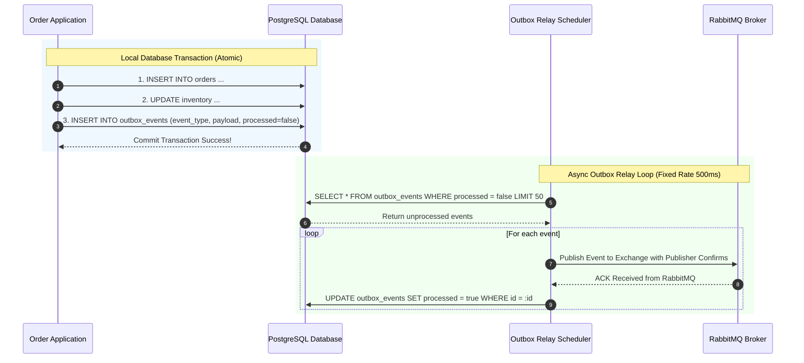
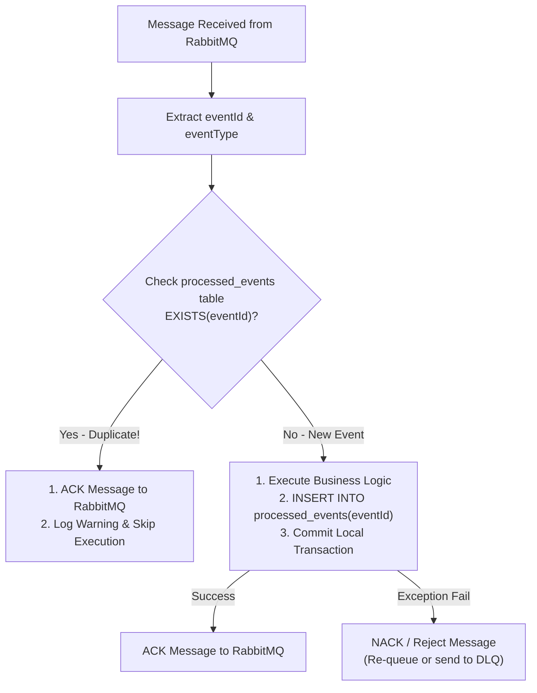

# Transactional Outbox & Idempotent Consumer Specification — Project MD5

## 1. Vấn đề Dual-Write trong Kiến trúc Microservices

Khi một Microservice cần vừa ghi dữ liệu vào Database của mình, vừa phát sự kiện (Publish Event) lên Message Broker (RabbitMQ), hành động này tạo ra sự cố **Dual-Write Problem**:
- Nếu DB commit thành công nhưng RabbitMQ bị ngắt kết nối -> Event bị mất vĩnh viễn, dữ liệu giữa các service bị bất đồng bộ.
- Nếu gửi RabbitMQ trước nhưng DB rollback -> Consumer xử lý sự kiện cho một dữ liệu không tồn tại.

---

## 2. Giải pháp Transactional Outbox Pattern



### Chi tiết Bảng `outbox_events`:
```sql
CREATE TABLE outbox_events (
    id UUID PRIMARY KEY DEFAULT uuid_generate_v4(),
    aggregate_type VARCHAR(100) NOT NULL,
    aggregate_id VARCHAR(100) NOT NULL,
    event_type VARCHAR(100) NOT NULL,
    payload TEXT NOT NULL, -- JSON String
    processed BOOLEAN NOT NULL DEFAULT FALSE,
    created_at TIMESTAMP WITH TIME ZONE DEFAULT CURRENT_TIMESTAMP
);

CREATE INDEX idx_outbox_unprocessed ON outbox_events(processed, created_at) WHERE processed = FALSE;
```

---

## 3. Idempotent Consumer Pattern (Chống trùng lặp Message)

Do RabbitMQ đảm bảo cơ chế **At-Least-Once Delivery**, sự kiện có thể được gửi lặp lại nhiều hơn 1 lần (ví dụ do đứt mạng đúng lúc Poller đang chờ ACK). Consumer bắt buộc phải áp dụng **Idempotent Consumer Pattern**.



### Chi tiết Bảng `processed_events`:
```sql
CREATE TABLE processed_events (
    event_id VARCHAR(128) PRIMARY KEY,
    event_type VARCHAR(100) NOT NULL,
    processed_at TIMESTAMP WITH TIME ZONE DEFAULT CURRENT_TIMESTAMP
);
```
